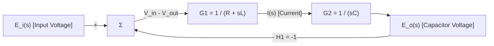

<!-- Gradient Divider -->


<!-- Repo Banner -->


<p align="center">
  <b>Series RLC Circuit – Transient Dynamics, Damping Analysis & Multi-Platform Simulation</b><br>
  <small><i>- A rigorous second-order circuit investigation featuring KVL integro-differential formulations, Laplace s-domain transfer functions, damping regimes (overdamped, critically damped, underdamped), Signal Flow Graphs, and multi-tool verification across Proteus, NI Multisim, MATLAB/Simulink, and Python -</i></small>
</p>

<p align="center">
  
  <a href="https://en.wikipedia.org/wiki/RLC_circuit"></a>
  <a href="https://www.mathworks.com/products/matlab.html"></a>
  <a href="https://www.labcenter.com/"></a>
  <a href="https://www.python.org/"></a>
  <a href="LICENSE"></a>
</p>

---

## 📌 Project Status: Archived & Academic Origins

> [!NOTE]
> **Archived Repository & University Coursework**  
> Originally researched, mathematically derived, simulated, and documented by **Nariman Ziaie** (December 2023) for his university **Electric Circuits Analysis** and **Linear Control Systems** coursework at **Islamic Azad University Central Tehran Branch**.  
> 
> **Academic Legacy:** This project served as an exhaustive academic investigation into second-order dynamic systems. It bridged theoretical integro-differential calculus with practical multi-environment computer-aided design (CAD) tools, validating system step responses across time-domain numerical scripts, classical SPICE engines, and visual block diagrams.  
> 
> **Archive Notice:** This repository is preserved in a read-only archived state for historical, educational, and reference purposes. For my active engineering work, modern open-source repositories, and hardware projects, explore my personal website and GitHub repositories listed below.

### 📖 The Origin Story

> *"The second-order series RLC circuit is one of the most elegant and fundamental systems in electrical engineering and physics. It embodies the perpetual dance of energy between two conjugate reactive storage elements: the electric field of a capacitor and the magnetic field of an inductor, mediated and dissipated by resistive friction as heat.*  
> 
> *During my university coursework in **Electric Circuits Analysis** and **Linear Control Systems**, I wanted to go beyond solving textbook second-order differential equations on paper. I wanted to build an end-to-end comparative study that explored the behavior of a series RLC loop from every possible angle—from analytical calculus and Laplace $s$-domain transfer functions to block diagrams, Signal Flow Graphs (SFG), and multi-platform simulations.*  
> 
> *Starting from first principles, I derived the KVL integro-differential equation, extracted the characteristic polynomial, and evaluated the three classic damping regimes: overdamped, critically damped, and underdamped. To prove that the mathematical models matched reality across different engineering tools, I implemented identical circuit configurations ($V_b = 2\,\text{V}$, $L = 10\,\text{mH}$, $C = 4.7\,\text{nF}$) across four distinct environments:*  
> 1. *SPICE transient analysis in **Proteus Design Suite**,*  
> 2. *Virtual benchtop instrumentation in **NI Multisim**,*  
> 3. *State-space block modeling in **MATLAB & Simulink**, and*  
> 4. *A custom discrete numerical simulation engine programmed from scratch in **Python** using trapezoidal companion integration.*  
> 
> *Comparing the waveforms across all four platforms provided profound intuition into numerical stability, damping factor $\alpha$, natural frequency $\omega_0$, and the exact boundary where smooth exponential rise transitions into oscillatory ringing.*  
> 
> *This repository stands as a preserved milestone of that foundational academic exploration—a complete reference suite demonstrating how theoretical physics, mathematical modeling, and multi-tool software simulation unite."*  
> — **Nariman Ziaie**

---

## 💡 Executive Summary & Core Capabilities

This project delivers an end-to-end analytical and computational treatment of a series RLC circuit subjected to step excitation, comparing theoretical mathematical predictions against four independent simulation environments:

* **Analytical Integro-Differential Modeling:** Complete KVL derivation of time-domain loop equations, governing voltage distributions across resistance ($R$), inductance ($L$), and capacitance ($C$).
* **Laplace Domain ($s$-Domain) Transfer Function:** Formal algebraic transformation establishing output capacitor voltage response $H(s) = \frac{V_o(s)}{V_i(s)} = \frac{1}{LC s^2 + RC s + 1}$ and root locus natural frequencies.
* **Tri-Modal Damping Regime Characterization:** Full mathematical and visual analysis of the three fundamental transient damping behaviors:
  * **Overdamped ($\alpha > \omega_0$ / $\zeta > 1$):** Sluggish non-oscillatory exponential rise ($R = 33\,\text{k}\Omega$).
  * **Critically Damped ($\alpha = \omega_0$ / $\zeta = 1$):** Fastest non-oscillatory rise time to steady state ($R = 3.3\,\text{k}\Omega$).
  * **Underdamped ($\alpha < \omega_0$ / $\zeta < 1$):** Oscillatory transient ringing with overshoot ($R = 330\,\Omega$).
* **Control Systems Architecture:** Linear system representation via **Block Diagrams** and **Signal Flow Graphs (SFG)** evaluated through Mason's Gain Rule.
* **Custom Python Discrete Numerical Engine:** Standalone computational solver utilizing the **trapezoidal companion model** (bilinear discrete integration with $\Delta t = 1\,\mu\text{s}$) and `matplotlib` plotting, requiring no proprietary CAD licenses.
* **MATLAB & Simulink Computational Models:** Continuous transfer function block simulations and companion MATLAB scripts verifying analytical transient curves.
* **Mixed-Signal SPICE Circuit Simulation:** Virtual breadboard schematic and multi-channel oscilloscope verification inside **Proteus Design Suite** (`.pdsprj`).
* **Benchtop Interactive Simulation:** Educational testbench setup in **National Instruments Multisim** (`.ms14`) with interactive virtual scopes and sweep generators.
* **Comprehensive 15-Page Technical Monograph:** Full academic documentation report (`Simulation & Analysis.pdf`) detailing formulas, schematics, and comparative oscilloscope captures.

---

## 📂 Repository & Project Structure

```text
RLC-Circuit-Analysis/
├── README.md                           # Comprehensive documentation & engineering runbook
├── LICENSE                             # MIT Open-Source License
├── .gitignore                          # Git ignore rules for simulation caches & backups
└── Series RLC Circuit/
    ├── Simulation & Analysis.pdf       # 15-page academic monograph & theoretical report
    ├── Python GUI/
    │   └── Series_RLC_Calculation.py   # Discrete trapezoidal companion model numerical solver
    ├── MATLAB & Simulink/
    │   ├── Series_RLC_Calculation.m    # MATLAB numerical script & transient response plot
    │   └── Series_RLC_Simulation.slx   # Simulink continuous-time block diagram model
    ├── Proteus/
    │   └── Series_RLC_Simulation.pdsprj # SPICE schematic & multi-channel oscilloscope model
    └── Multisim/
        └── Series_RLC_Simulation.ms14  # NI Multisim interactive schematic & transient scope
```

---

## ⚡ Circuit Theory & Mathematical Modeling

```text
Series RLC Circuit Loop:
       ┌───────[ R ]───────[ L ]───────┐
       │     Resistor   Inductor       │
       ▲                               │
    + (~) v_i(t)                    [ C ] Capacitor ──► v_o(t)
       │                               │
       └───────────────────────────────┘
```

### 1. Time-Domain KVL Integro-Differential Equation
Applying Kirchhoff's Voltage Law (KVL) around the single-mesh loop for $t \ge 0$:

$$-v_i(t) + v_R(t) + v_L(t) + v_C(t) = 0$$

$$v_i(t) = R i(t) + L \frac{di(t)}{dt} + \frac{1}{C} \int_0^t i(\tau)\,d\tau + v_C(0)$$

Taking the output across the capacitor $v_o(t) = v_C(t) = \frac{1}{C}\int_0^t i(\tau)\,d\tau$:
$$\frac{dv_o(t)}{dt} = \frac{1}{C} i(t) \implies i(t) = C \frac{dv_o(t)}{dt}$$

Differentiating the KVL equation with respect to time yields the second-order linear ordinary differential equation (ODE):
$$L C \frac{d^2 v_o(t)}{dt^2} + R C \frac{dv_o(t)}{dt} + v_o(t) = v_i(t)$$

$$\frac{d^2 v_o(t)}{dt^2} + \frac{R}{L} \frac{dv_o(t)}{dt} + \frac{1}{LC} v_o(t) = \frac{1}{LC} v_i(t)$$

### 2. Laplace Domain ($s$-Domain) Transfer Function
Assuming zero initial conditions ($i(0^-) = 0$, $v_C(0^-) = 0$), transforming the KVL loop into the complex frequency $s$-domain:

$$V_i(s) = R I(s) + s L I(s) + \frac{1}{sC} I(s) = \left( \frac{L C s^2 + R C s + 1}{sC} \right) I(s)$$

Solving for loop current $I(s)$:
$$I(s) = \frac{sC}{L C s^2 + R C s + 1} V_i(s)$$

Since the output voltage is taken across the capacitor:
$$V_o(s) = \frac{1}{sC} I(s) = \frac{1}{sC} \left( \frac{sC}{L C s^2 + R C s + 1} \right) V_i(s)$$

The standard second-order voltage transfer function $H(s)$ is:
$$H(s) = \frac{V_o(s)}{V_i(s)} = \frac{1}{L C s^2 + R C s + 1} = \frac{\frac{1}{LC}}{s^2 + \frac{R}{L}s + \frac{1}{LC}} = \frac{\omega_0^2}{s^2 + 2\alpha s + \omega_0^2}$$

### 3. Characteristic Equation & Natural Frequencies
Setting the denominator polynomial to zero yields the characteristic equation:
$$s^2 + \frac{R}{L}s + \frac{1}{LC} = 0 \implies s^2 + 2\alpha s + \omega_0^2 = 0$$

Solving for the roots (natural frequencies $s_{1,2}$):
$$s_{1,2} = -\frac{R}{2L} \pm \sqrt{\left(\frac{R}{2L}\right)^2 - \frac{1}{LC}} = -\alpha \pm \sqrt{\alpha^2 - \omega_0^2}$$

Where:
* **Neper Frequency / Damping Factor ($\alpha$):** 
  $$\alpha = \frac{R}{2L} \quad [\text{Np/s}]$$
* **Undamped Natural Frequency / Resonance ($\omega_0$):** 
  $$\omega_0 = \frac{1}{\sqrt{LC}} \quad [\text{rad/s}]$$
* **Damping Ratio ($\zeta$):** 
  $$\zeta = \frac{\alpha}{\omega_0} = \frac{R}{2}\sqrt{\frac{C}{L}}$$
* **Circuit Time Constant ($\tau$):** 
  $$\tau = \frac{2L}{R} \quad [\text{s}]$$

### 4. Classification of Damping Regimes
The circuit's physical response to a step input $V_b = 2\,\text{V}$ depends entirely on the discriminant $\Delta = \alpha^2 - \omega_0^2$:

| Damping State | Condition | Root Characteristics ($s_1, s_2$) | Resistance ($R$) | Transient Voltage Response $v_o(t)$ |
| :--- | :---: | :--- | :---: | :--- |
| **Overdamped** | $\alpha > \omega_0$ ($\zeta > 1$) | Two distinct real negative roots: $s_1 \ne s_2 < 0$ | $R = 33\,\text{k}\Omega$ | Sluggish, monotonic rise to steady-state with no overshoot ($v_o(t) = V_b + A_1 e^{s_1 t} + A_2 e^{s_2 t}$) |
| **Critically Damped** | $\alpha = \omega_0$ ($\zeta = 1$) | Repeated real negative roots: $s_1 = s_2 = -\alpha$ | $R = 3.3\,\text{k}\Omega$ ($R_{\text{crit}} \approx 2.92\,\text{k}\Omega$) | Fastest possible monotonic response without oscillatory overshoot ($v_o(t) = V_b + (A_1 + A_2 t) e^{-\alpha t}$) |
| **Underdamped** | $\alpha < \omega_0$ ($\zeta < 1$) | Complex conjugate pair: $s_{1,2} = -\alpha \pm j\omega_d$ | $R = 330\,\Omega$ | Damped oscillatory ringing with pronounced overshoot ($v_o(t) = V_b + e^{-\alpha t}[B_1 \cos(\omega_d t) + B_2 \sin(\omega_d t)]$) |

Where the damped natural frequency $\omega_d$ is:
$$\omega_d = \sqrt{\omega_0^2 - \alpha^2}$$

For the project component values ($L = 10\,\text{mH}$, $C = 4.7\,\text{nF}$):
$$\omega_0 = \frac{1}{\sqrt{10\times 10^{-3} \times 4.7\times 10^{-9}}} = \frac{1}{\sqrt{4.7\times 10^{-11}}} \approx 145{,}865\,\text{rad/s} \quad (f_0 \approx 23.2\,\text{kHz})$$

$$R_{\text{crit}} = 2 \sqrt{\frac{L}{C}} = 2 \sqrt{\frac{10\times 10^{-3}}{4.7\times 10^{-9}}} \approx 2 \times 1458.65 \approx 2917\,\Omega \approx 2.92\,\text{k}\Omega$$

* $R = 33\,\text{k}\Omega > 2.92\,\text{k}\Omega \implies$ **Overdamped**
* $R = 3.3\,\text{k}\Omega \approx 2.92\,\text{k}\Omega \implies$ **Critically Damped** (standard practical E12 resistor choice)
* $R = 330\,\Omega < 2.92\,\text{k}\Omega \implies$ **Underdamped**

---

## 🧮 Discrete Companion Integration Algorithm (Python & MATLAB)

To numerically simulate the continuous differential loop without third-party proprietary solvers, the Python (`Series_RLC_Calculation.py`) and MATLAB (`Series_RLC_Calculation.m`) scripts implement a **trapezoidal companion model** with uniform time step $\Delta t = 1\,\mu\text{s}$:

Applying the trapezoidal integration rule across $[(n-1)\Delta t, n\Delta t]$:
$$v_L[n] = L \frac{i[n] - i[n-1]}{\Delta t}$$

$$v_C[n] = v_C[n-1] + \frac{\Delta t}{2C} (i[n] + i[n-1])$$

Substituting into the loop KVL $v_i[n] = R \frac{i[n] + i[n-1]}{2} + v_L[n] + v_C[n]$ with step input $v_i = V_b$:

$$V_b = \frac{R}{2} (i[n] + i[n-1]) + \frac{L}{\Delta t}(i[n] - i[n-1]) + v_C[n-1] + \frac{\Delta t}{2C}(i[n] + i[n-1])$$

Regrouping terms to solve for current $i[n]$ explicitly at step $n$:

$$i[n] = \frac{i[n-1] \left( \frac{L}{\Delta t} - \frac{R}{2} - \frac{\Delta t}{2C} \right) + V_b - v_C[n-1]}{\frac{L}{\Delta t} + \frac{R}{2} + \frac{\Delta t}{2C}}$$

This formulation guarantees A-stable, second-order accurate numerical convergence, generating exact capacitor voltage trajectories for all three damping states.

---

## 🔄 Control Systems: Block Diagram & Signal Flow Graph

The series RLC system can be decomposed into an error-feedback control loop:



### Signal Flow Graph (SFG) & Mason's Rule Verification
* **Forward Path Gain ($P_1$):**
  $$P_1 = G_1 \cdot G_2 = \left( \frac{1}{R + sL} \right) \left( \frac{1}{sC} \right) = \frac{1}{sC(R + sL)}$$
* **Feedback Loop Gain ($L_1$):**
  $$L_1 = - G_1 \cdot G_2 \cdot H_1 = -\frac{1}{sC(R + sL)}$$
* **System Graph Determinant ($\Delta$):**
  $$\Delta = 1 - L_1 = 1 + \frac{1}{sC(R + sL)} = \frac{sC(R + sL) + 1}{sC(R + sL)}$$
* **Closed-Loop Transfer Function via Mason's Gain Formula:**
  $$T(s) = \frac{P_1 \Delta_1}{\Delta} = \frac{\frac{1}{sC(R + sL)} \times 1}{\frac{sC(R + sL) + 1}{sC(R + sL)}} = \frac{1}{L C s^2 + R C s + 1}$$

This confirms exact equivalence between the physical circuit differential equation and linear feedback control theory.

---

## 🧪 Multi-Platform Simulation Suite & Runbook

### 1. Proteus Design Suite (`Series RLC Circuit/Proteus/`)
* **File:** [`Series_RLC_Simulation.pdsprj`](Series%20RLC%20Circuit/Proteus/Series_RLC_Simulation.pdsprj)
* **Model:** Mixed-signal schematic with DC pulse voltage generator ($2\,\text{V}$), $10\,\text{mH}$ inductor, $4.7\,\text{nF}$ capacitor, and selectable resistance values ($330\,\Omega$, $3.3\,\text{k}\Omega$, $33\,\text{k}\Omega$).
* **Instrumentation:** Multi-channel Digital Oscilloscope attached across input generator (Channel A) and capacitor voltage (Channel B).

### 2. National Instruments Multisim (`Series RLC Circuit/Multisim/`)
* **File:** [`Series_RLC_Simulation.ms14`](Series%20RLC%20Circuit/Multisim/Series_RLC_Simulation.ms14)
* **Model:** SPICE circuit with virtual Agilent / Tektronix 2-channel oscilloscope capturing instantaneous capacitor voltage and current transients across interactive resistor switches ($10\,\Omega, 100\,\Omega, 1\,\text{k}\Omega$).

### 3. MATLAB & Simulink (`Series RLC Circuit/MATLAB & Simulink/`)
* **Script:** [`Series_RLC_Calculation.m`](Series%20RLC%20Circuit/MATLAB%20%26%20Simulink/Series_RLC_Calculation.m)
* **Simulink Model:** [`Series_RLC_Simulation.slx`](Series%20RLC%20Circuit/MATLAB%20%26%20Simulink/Series_RLC_Simulation.slx)
* **Architecture:** Continuous Laplace transfer function blocks (`Transfer Fcn`) and discrete integrator models comparing time-domain waveforms simultaneously.

### 4. Standalone Python Solver (`Series RLC Circuit/Python GUI/`)
* **File:** [`Series_RLC_Calculation.py`](Series%20RLC%20Circuit/Python%20GUI/Series_RLC_Calculation.py)
* **Dependencies:** Python 3.x, NumPy, Matplotlib.
* **Execution:** Solves the companion matrix equation across $N = 500$ time iterations ($\Delta t = 1\,\mu\text{s}$) and renders the comparative damping plot shown below:

```text
Voltage (V)
  3.0 ┼                             ╭──╮ [Underdamped - Ringing & Overshoot]
      │                            ╭╯  ╰╮
  2.0 ┼───────────────────────────╭╯────┴──────────────── [Steady State = 2V]
      │                         ╭─╯   [Critically Damped - Fastest Smooth Rise]
  1.0 ┼                      ╭──╯
      │                 ╭────╯        [Overdamped - Sluggish Exponential Rise]
  0.0 ┼─────────────────┴────────────────────────────────────────► Time (s)
      0               100us            200us            500us
```

---

## 🔬 Technical Report & Documentation Summary

The repository includes a comprehensive 15-page academic monograph and engineering report ([`Series RLC Circuit/Simulation & Analysis.pdf`](Series%20RLC%20Circuit/Simulation%20%26%20Analysis.pdf)):

* **Section 1-1 (Theoretical Calculations):** Time-domain KVL derivation, differential operators, and complete Laplace transform derivations.
* **Section 1-2 (Block Diagrams & SFG):** Signal Flow Graph topology and Mason's gain formula validation.
* **Section 1-3 & 1-4 (Damping Factor & Step Response):** Mathematical proof of roots, time constants, and step response profiles.
* **Section 1-5 (Proteus Simulation):** Schematic captures and multi-trace oscilloscope captures for $R = 330\,\Omega, 3.3\,\text{k}\Omega, 33\,\text{k}\Omega$.
* **Section 1-6 (NI Multisim Simulation):** Interactive virtual instrument captures and component sweep analysis.
* **Section 1-7 (MATLAB & Simulink):** Continuous and discrete Simulink model diagrams and plotted analytical curves.
* **Section 1-8 (Python GUI & Scripting):** Discrete trapezoidal integration algorithm and Matplotlib graphical output.

---

## 🚀 Getting Started & Execution Runbook

### Prerequisites
* **Python:** Python 3.8+ with `numpy` and `matplotlib` installed:
  ```bash
  pip install numpy matplotlib
  ```
* **MATLAB (Optional):** MATLAB R2020a+ with Simulink.
* **SPICE Tools (Optional):** Labcenter Proteus 8.x or NI Multisim 14.x.

### Step 1: Clone Repository
```bash
git clone https://github.com/Nariman-Z/RLC-Circuit-Analysis.git
cd RLC-Circuit-Analysis
```

### Step 2: Run Python Numerical Simulation
```bash
python3 "Series RLC Circuit/Python GUI/Series_RLC_Calculation.py"
```
A Matplotlib window will display the three comparative step responses (Overdamped in blue, Critically Damped in green, and Underdamped in red).

### Step 3: Run MATLAB Simulation
Launch MATLAB, navigate to `Series RLC Circuit/MATLAB & Simulink/`, and run:
```matlab
Series_RLC_Calculation
```
Or double-click [`Series_RLC_Simulation.slx`](Series%20RLC%20Circuit/MATLAB%20%26%20Simulink/Series_RLC_Simulation.slx) to inspect the Simulink block diagram.

---

## 🔍 Diagnostics, Analytical Insights & Physical Reality

### 1. Ideal Circuit Models vs. Physical Reality
* **Inductor Direct Current Resistance (DCR / ESR):** Real inductors contain significant internal winding resistance ($R_{\text{series}}$). In physical breadboard circuits, this parasitic ESR adds directly to $R$, slightly increasing the effective damping factor $\alpha = \frac{R + R_{\text{ESR}}}{2L}$ and reducing peak overshoot.
* **Capacitor Equivalent Series Inductance (ESL) & Leakage:** High-frequency parasitic inductance and dielectric losses in capacitors introduce minor secondary ripples during fast step transitions.
* **Component Tolerances:** Practical resistors ($\pm 5\%$) and passive capacitors ($\pm 10\% - 20\%$) mean that achieving true critical damping ($\zeta = 1.000$) requires potentiometer trimming rather than nominal standard-value resistors.

### 2. Numerical Integration Time-Step Considerations
* In [`Series_RLC_Calculation.py`](Series%20RLC%20Circuit/Python%20GUI/Series_RLC_Calculation.py), the time step is configured to $\Delta t = 1\,\mu\text{s}$.
* Since the resonant frequency is $f_0 \approx 23.2\,\text{kHz}$ (oscillation period $T_0 = \frac{1}{f_0} \approx 43\,\mu\text{s}$), a time step of $1\,\mu\text{s}$ provides $> 40$ discrete samples per oscillation cycle, avoiding numerical dispersion while adhering to the Nyquist-Shannon criterion.

---

## 🏛️ Project Archive & More Projects

> [!IMPORTANT]
> **This repository is officially archived.**  
> `RLC-Circuit-Analysis` reflects foundational academic research and multi-platform computational modeling completed during university electrical engineering studies. Active development has concluded, and this repository is preserved for reference.
>
> To explore my latest active engineering projects, research, and open-source software:

### 🌐 [Personal Website & Portfolio](https://nariman-z.pages.dev/)
* **Official URL:** [**nariman-z.pages.dev**](https://nariman-z.pages.dev/)
* **Overview:** Comprehensive showcase of embedded engineering projects, hardware systems, full-stack software development, technical articles, and interactive demos.

### 💻 [GitHub Repositories](https://github.com/Nariman-Z?tab=repositories)
* **GitHub Profile:** [**github.com/Nariman-Z**](https://github.com/Nariman-Z)
* **Repository Catalog:** [**github.com/Nariman-Z?tab=repositories**](https://github.com/Nariman-Z?tab=repositories)
* **Overview:** Complete collection of open-source repositories spanning microcontroller firmware, IoT architectures, circuit simulations, web platforms, and mobile applications.

---

## 📄 License & Developer Attribution

Licensed under the terms of the **MIT License**. See the full [`LICENSE`](LICENSE) file for complete details.

---

<div align="center">

### Made with ❤️ by [Nariman_Z](https://github.com/Nariman-Z)  
🌐 [Personal Website & Portfolio](https://nariman-z.pages.dev/)

</div>

<!-- Gradient Divider -->


_Last Update: November 2026_
